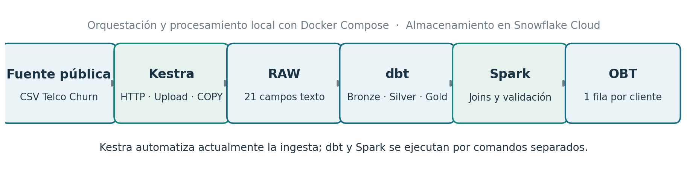
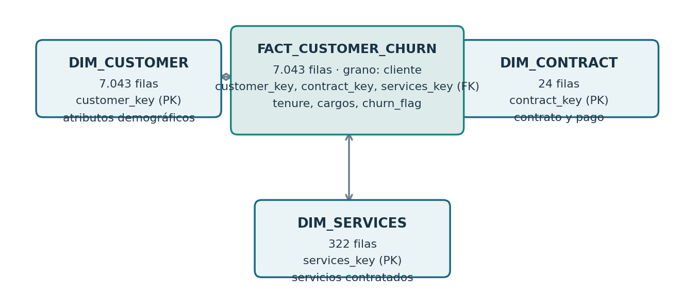

# PSet #2 — Pipeline de datos ELT para Churn

Proyecto académico de Ciencia de Datos. Prepara el dataset público **IBM Telco Customer Churn** con **Kestra → Snowflake RAW → dbt Bronze/Silver/Gold → Apache Spark → Snowflake OBT**.

> **Alcance real:** la ingesta está automatizada con Kestra; **dbt y Spark se ejecutan por separado mediante comandos Docker Compose**. La fuente contiene un único corte por cliente, no un historial mensual. Este repositorio prepara los datos; no entrena todavía un modelo ni evalúa el efecto real de una campaña de retención.

## 1. Resultado verificado

| Componente | Evidencia de las ejecuciones del laboratorio |
|---|---|
| RAW | 7.043 filas; 7.043 `CUSTOMER_ID` distintos; 0 duplicados después de corregir la reingesta |
| Calidad | 11 `TOTAL_CHARGES` vacíos (0,16 %); los 11 tienen `TENURE=0` y `CHURN=No` |
| dbt | 6 modelos construidos (Bronze 1, Silver 1, Gold 4); **36/36 pruebas PASS** |
| Gold | `DIM_CUSTOMER`: 7.043; `DIM_CONTRACT`: 24; `DIM_SERVICES`: 322; `FACT_CUSTOMER_CHURN`: 7.043 |
| OBT | 7.043 filas y clientes únicos, 1.869 abandonos, 11 cargos nulos; validada con Spark sin `root` |
| Programación | **Ejecución automática confirmada**: 16/11/2026, 01:00 (hora mostrada en Kestra), `SUCCESS`, 8,23 s; trigger identificado en la interfaz. Horario semanal previsto: lunes 03:00 `America/Guayaquil` (revisar su restauración tras la prueba) |
| Backfill | **Pendiente evidencia final** de una ejecución identificada como backfill, con fecha lógica y estado `SUCCESS` |

Los conteos son del snapshot público utilizado. No deben extrapolarse como métricas operativas de una organización real.

## 2. Arquitectura y grano



- **RAW:** `PSET2_CHURN.RAW.TELCO_CUSTOMER_CHURN`, campos originales como texto más fecha de ingesta técnica.
- **Bronze:** vista `BRZ_TELCO_CUSTOMERS`; estandarización inicial y conversión controlada de tipos.
- **Silver:** tabla `SLV_TELCO_CUSTOMERS`; una fila por cliente, cargos vacíos conservados como `NULL` con indicadores explícitos.
- **Gold:** star schema con tres dimensiones y `FACT_CUSTOMER_CHURN`.
- **OBT:** `PSET2_CHURN.OBT.CUSTOMER_CHURN_OBT`; **una fila por cliente** para futuros modelos de Machine Learning.



`INGESTED_AT` corresponde a la carga técnica; no representa un evento de abandono y no debe emplearse como predictor temporal.

## 3. Requisitos

- Docker Desktop con contenedores Linux y Docker Compose, PowerShell y conexión a Internet.
- Cuenta de Snowflake con permisos administrativos para configurar roles, warehouse, esquemas y usuarios de servicio.
- Git instalado para versionar el repositorio.
- Para reejecutar la ingesta, el YAML de Kestra debe estar **exportado al directorio `kestra/flows/`**. El flujo usado en la interfaz debe ser la fuente de verdad (no se presume que un archivo local antiguo contenga las últimas correcciones).

## 4. Estructura del repositorio

```text
pset_2/
├── docker-compose.yml
├── docker-compose.dbt.yml
├── docker-compose.spark.yml
├── .env.example
├── .env.dbt.example
├── .gitignore
├── README.md
├── kestra/flows/        # Exportación del YAML real de ingesta_telco_raw
├── dbt/                 # Modelos, sources, macros, tests, Dockerfile
├── spark/jobs/          # build_obt.py
└── docs/                # SQL, diagramas, memo, registro de evidencias
```

**No subir al repositorio:** `.env`, `.env.dbt`, `.env.snowflake`, `secrets/`, claves `.pem` o contraseñas/token en archivos YAML. La codificación Base64 usada por Kestra **no equivale a cifrado**. El `.gitignore` recomendado sí permite versionar `.env.example`, `.env.dbt.example` y `dbt/profiles.yml` (este perfil no contiene contraseñas literales).

## 5. Configuración inicial

Desde la carpeta raíz `pset_2`:

```powershell
Copy-Item .env.example .env
Copy-Item .env.dbt.example .env.dbt
notepad .env
notepad .env.dbt
```

- En `.env`, establecer contraseñas locales para PostgreSQL y la interfaz de Kestra.
- En `.env.dbt`, configurar `SNOWFLAKE_ACCOUNT` con el identificador `organización-cuenta` de Snowflake.
- Conservar localmente la clave privada RSA cifrada en `secrets/snowflake_private_key.pem`, registrada previamente mediante la **clave pública** del usuario de servicio `PSET2_KESTRA_SVC` en Snowflake.
- Configurar `.env.snowflake` como en el entorno del laboratorio con las variables `SECRET_SNOWFLAKE_PRIVATE_KEY` y `SECRET_SNOWFLAKE_PRIVATE_KEY_PASSWORD`, ambas codificadas en Base64. Deben corresponder a **la misma clave privada y su frase de contraseña**. No incluir valores reales en el repositorio.
- Los servicios `dbt` y `spark` leen `.env.dbt` y `.env.snowflake`. Kestra debe tener también cargado `.env.snowflake` mediante `env_file` en `docker-compose.yml`.

Para preparar Snowflake, ejecutar en Snowsight los scripts incluidos en `docs/` según el rol necesario:

1. `docs/snowflake_setup.sql` — base, warehouse y esquemas.
2. `docs/grants_dbt.sql` — rol y permisos para modelos dbt.
3. `docs/grants_spark.sql` — rol y permisos para leer Gold y escribir OBT.
4. Crear/verificar manualmente el usuario de servicio y los permisos RAW de Kestra, así como `RAW.CSV_CHURN_FORMAT` y `RAW.CHURN_STAGE`. **Estos objetos se crearon durante el laboratorio y deben existir antes de ejecutar la ingesta.**

Los scripts no sustituyen el registro de la clave RSA en el usuario de servicio de Snowflake.

## 6. Iniciar la infraestructura

```powershell
docker compose config --quiet
docker compose up -d
docker compose ps
```

Abrir Kestra en <http://localhost:8080>.

**Ingesta:** importar o mantener la versión actual del flujo `pset2.churn.ingesta_telco_raw` desde `kestra/flows/`. El flujo descarga el CSV de IBM, crea RAW si falta, limpia el stage, sube el CSV, reinicia RAW, ejecuta `COPY INTO` y valida el conteo. En la versión corregida el orden es:

```text
descargar_csv → crear_tabla_raw → limpiar_stage → subir_stage
             → reiniciar_raw → cargar_raw → validar_carga
```

**Advertencia:** el `TRUNCATE` de RAW ocurre antes de `COPY INTO`. Es una carga completa idempotente para ejecuciones **secuenciales de un CSV estático**, no una recarga transaccional ni segura ante ejecuciones simultáneas. Si falla después de truncar, RAW puede quedar temporalmente vacío.

**Trigger:** se verificó una ejecución automática el 16/11/2026 a las 01:00 (hora mostrada por Kestra), con estado `SUCCESS` y duración 8,23 s. El horario semanal propuesto es `cron: "0 3 * * 1"`, `timezone: America/Guayaquil` y `recoverMissedSchedules: NONE`; se modificó temporalmente el horario para probarlo y debe comprobarse su restauración. Las tareas de descarga, upload y carga usan retries de tres intentos, con intervalo de 10 s. Capturas: `docs/evidencia_kestra_trigger_20261116.png` y `docs/evidencia_snowflake_raw_20261116.png`.

**Backfill:** requiere ejecutar manualmente la recuperación de un intervalo desde la interfaz de Kestra y conservar una captura con identificador, fecha programada y estado final. La ausencia de duplicados en RAW por sí sola **no demuestra** que se realizó un backfill.

## 7. Construir Bronze, Silver y Gold con dbt

```powershell
docker compose -f docker-compose.yml -f docker-compose.dbt.yml build dbt
docker compose -f docker-compose.yml -f docker-compose.dbt.yml run --rm dbt debug
docker compose -f docker-compose.yml -f docker-compose.dbt.yml run --rm dbt run
docker compose -f docker-compose.yml -f docker-compose.dbt.yml run --rm dbt test
```

Referencia del laboratorio: `PASS=6` modelos y `PASS=36` tests, sin errores. Las reglas de calidad incluyen `source()`, `ref()`, `unique`, `not_null`, `accepted_values`, `relationships` y tests SQL sobre la cardinalidad y el target.

## 8. Construir y validar la OBT con Spark

```powershell
docker compose -f docker-compose.yml -f docker-compose.spark.yml build spark
docker compose -f docker-compose.yml -f docker-compose.spark.yml run --rm spark
```

El script `spark/jobs/build_obt.py` lee Gold, realiza tres joins por claves, valida conteos antes y después de escribir y persiste la OBT mediante `overwrite` del snapshot. La versión corregida **no necesita `--user 0:0`**: recibe la clave RSA cifrada mediante variables de entorno y la descifra en memoria.

El primer arranque puede descargar bibliotecas del conector Spark–Snowflake desde Maven; debe existir conexión a Internet en Docker.

## 9. Validar en Snowflake

Ejecutar `docs/validacion_final.sql` en Snowsight usando `SYSADMIN` y el warehouse `PSET2_WH`. Los indicadores esperados son:

- RAW: 7.043 filas, 7.043 IDs distintos, cero duplicados.
- Gold y OBT: 7.043 clientes; 1.869 abandonos; 11 cargos nulos.

Si se repite la ingesta, volver a ejecutar dbt y Spark antes de validar la OBT. Kestra **no los invoca automáticamente** en la implementación actual.

## 10. Batch, límites y próximos pasos

**Batch:** la fuente es un CSV estático y el caso de uso no exige predicciones en tiempo real. Streaming requeriría eventos de negocio continuos y latencia reducida; no se implementó.

**Limitaciones conocidas:** falta de historial por cliente; trigger programado validado, pero backfill histórico aún sin evidencia concluyente en los materiales compartidos; full refresh no atómico; dbt/Spark fuera del flujo Kestra; ausencia de medición productiva de drift o efecto comercial de campañas. Una mejora futura sería cargar a tabla intermedia y efectuar un reemplazo controlado, además de orquestar dbt y Spark y probar recuperación de fallos.

## 11. Versionar y publicar de forma segura

Antes de hacer commit:

```powershell
git status
git add README.md docs/ dbt/ spark/ kestra/ docker-compose.yml docker-compose.dbt.yml docker-compose.spark.yml .gitignore .env.example .env.dbt.example
git diff --cached --name-only
```

Revisar que no haya secretos ni archivos `.env` privados y, cuando esté todo correcto:

```powershell
git commit -m "Document validated ELT pipeline and final evidence"
git push
```

El informe técnico está en `docs/PSet2_memo_Donoso.pdf`; el entregable también puede subirse por separado a la plataforma de la asignatura.

## Fuente del dataset

- IBM (CSV): <https://raw.githubusercontent.com/IBM/telco-customer-churn-on-icp4d/master/data/Telco-Customer-Churn.csv>
- Kaggle (catálogo): <https://www.kaggle.com/datasets/blastchar/telco-customer-churn>
